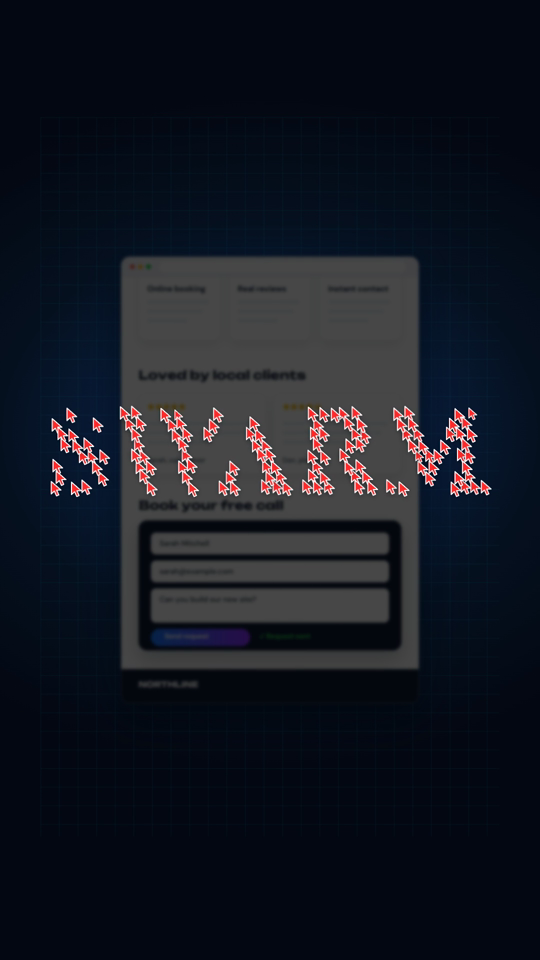

# Swarm website builder video

Hundreds of red cursors and typing carets build a real website while the page scrolls. Then they fly together and spell a word. Everything is code: the page is plain HTML and CSS, the camera is CSS transforms, and every click and key sound is generated in Python and placed on its exact frame.

No After Effects. No Blender. I described the idea to Claude and it wrote this.

| Opening | Building | Payoff |
|---|---|---|
|  |  |  |

## What you need

- [Node.js](https://nodejs.org) 18 or newer
- [FFmpeg](https://ffmpeg.org) on your PATH
- Python 3 with `numpy` and `scipy` (only for the sound)

## Make the video

```bash
npm install
npx playwright install chromium

# 1. quick check: a few PNG stills in out/frames
node render.cjs samples out/frames

# 2. the full silent video, plus the list of sound events
EVENTS_OUT=out/events.json node render.cjs full out/picture.mp4

# 3. the sound, built from that event list (1200 frames = 20 s)
python mix.py out/events.json 1200 out/sound.wav

# 4. put them together
ffmpeg -i out/picture.mp4 -i out/sound.wav -map 0:v -map 1:a -c:v copy -c:a aac -b:a 256k -shortest out/swarm.mp4
```

On Windows PowerShell, set the variable first: `$env:EVENTS_OUT="out/events.json"`, then run the render command.

You can also open `swarm.html` through any local web server and call `renderFrame(500)` in the browser console to see any single frame.

## How it works

`swarm.js` builds the page from small tasks. Each task has one cursor and one job:

- **box**: a cursor drags out a rectangle, which then becomes a styled section
- **text**: a caret types a line letter by letter, with a little pop on each character
- **tiles**: an image is cut into 40 tiles and each one is carried in by its own cursor
- **clicks**: a cursor presses a button and leaves a ripple

On top of that, an idle swarm of 120 cursors circles the part of the page being built and clicks at random. At the end, every cursor flies to a point sampled from the word SWARM.

`renderFrame(f)` works out every element's state from the frame number alone, so any frame can be rendered on its own and always looks the same. Every action also pushes an event (`window.EVENTS`), which `mix.py` turns into clicks, key presses, snaps and the final hit.

## Make it yours

- Change the website: edit the `box(...)` and `text(...)` calls in `swarm.js`. The demo business "NORTHLINE" and its reviews are made up.
- Change the final word: edit `'SWARM'` in the `TARGETS` block.
- Change the on-screen captions: edit the `CAPS` list.
- Change the cursor colour: edit the `ARROW` SVG.

## Licence

Code: MIT, see `LICENSE`. Fonts: DM Sans and Unbounded, both under the SIL Open Font License 1.1 (`assets/fonts/OFL-*.txt`).
